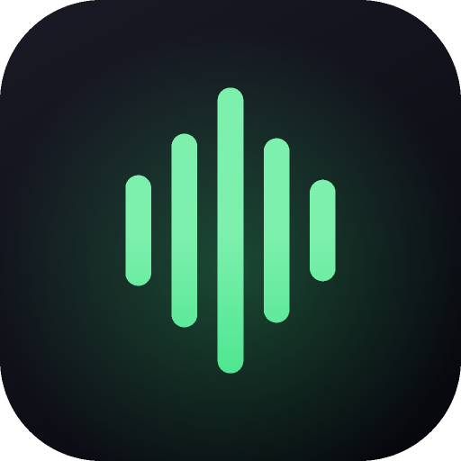
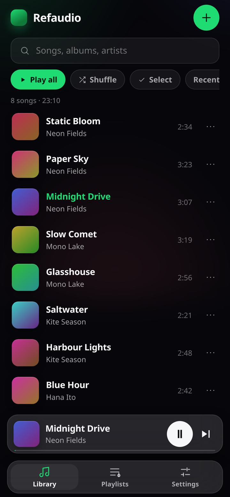
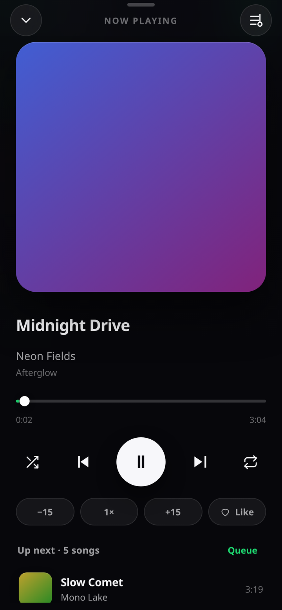
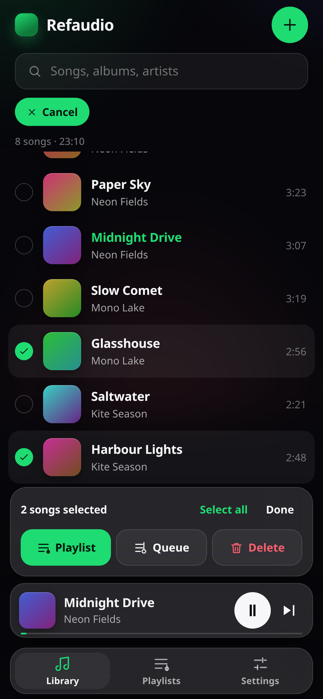

<p align="center">
  
</p>

<h1 align="center">Refaudio</h1>

<p align="center">
  <b>Your music. Your phone. No cloud in the middle.</b><br />
  A frosted-glass, offline-first music player that installs to the iPhone Home&nbsp;Screen
  and keeps your whole library on the device.
</p>

<p align="center">
  
  
  
  
  
  
  
  
  
</p>

<p align="center">
  <a href="#screens">Screens</a> ·
  <a href="#features">Features</a> ·
  <a href="#install-on-your-iphone">Install</a> ·
  <a href="#getting-music-in">Import</a> ·
  <a href="#how-it-works">How it works</a> ·
  <a href="#development">Development</a> ·
  <a href="#troubleshooting">Troubleshooting</a>
</p>

---

## Screens

| Library | Now playing | Multi-select |
| :--: | :--: | :--: |
|  |  |  |

<sub>Captured from the production build at iPhone 11 size — 390 × 844, 3× — with real tags and artwork.</sub>

## Why this exists

Streaming turned music into a rental. Refaudio goes the other way: point it at the
FLACs, MP3s and M4As you already own, install it once, and it behaves like a music
app — dark, thumb-sized, instant, and completely happy in aeroplane mode.

- **Nothing leaves the phone.** Audio, tags, covers, playlists and the queue live in
  IndexedDB inside the app's own storage bucket. No account, no server-side database,
  no telemetry.
- **It is a real PWA.** Installed to the Home Screen it runs standalone, keeps playing
  when the screen locks, and appears on the lock screen and in Control Center with
  artwork and working ⏮ ⏸ ⏭.
- **Built for a phone, not a browser.** Safe-area insets, 44 px targets, springy
  sheets, frosted glass, and a virtualised list that stays smooth with thousands of
  tracks.

## Features

| Feature | What you get |
| --- | --- |
| 🎧 **Playback** | Queue, permutation shuffle, repeat one/all, ±15 s skip, speed control, seek bar, hardware volume keys, background audio and Media Session controls. |
| 🗂 **Library** | Search, sort by added / title / artist / album / duration, group by album or artist, deterministic gradient art when a file has no cover. |
| ✅ **Multi-select** | Tap **Select**, tick rows or *Select all*, then queue them, add them to a playlist, or delete them in one go. |
| 🎵 **Playlists** | Create, rename and delete playlists; add or remove tracks; play or shuffle a playlist directly. |
| 📥 **Import** | iOS Files picker (local, iCloud Drive, USB) or **Pull from PC** — drop files in a folder and stream them over Wi-Fi from a tiny Node server. |
| 💾 **Backup** | One ZIP with a JSON manifest plus every original file and cover. Restore merges by id and skips duplicates. |
| 🔒 **Privacy** | No network calls at runtime, no analytics, no CDN fonts or scripts. User data is never rendered through `innerHTML`. |
| 📴 **Offline** | The service worker precaches the shell (~529 KB), so the app opens with zero connectivity. |

> Unsupported containers are reported instead of failing silently: **Ogg/Opus, WMA,
> WavPack, Monkey's Audio, DSD** and DRM `m4p` cannot be decoded by iOS. MP3, M4A/AAC,
> ALAC, FLAC, WAV, AIFF and CAF all work.

## Install on your iPhone

**Requirements** — Node.js 20+ on a computer, an iPhone on iOS 15 or newer (developed
against an iPhone 11 on iOS 17), and both devices on the same Wi-Fi.

### 1. Build it and serve it from your computer

```bash
git clone https://github.com/grivia0/Refaudio.git
cd Refaudio
npm install
npm run build
mkdir -p ~/Music/Refaudio-Inbox
npm run inbox            # static host + inbox API on http://0.0.0.0:8765
```

### 2. Open it on the phone and install it

Go to `http://<your-pc-ip>:8765/` in **Safari**, then **Share → Add to Home Screen →
Add**. Launch it from the new icon: it runs standalone, with no Safari chrome.

<details>
<summary>Why HTTPS matters (and how to get it for free)</summary>

"Add to Home Screen" works over plain HTTP, but **Service Workers require a secure
context** — without HTTPS the app still plays music, it just cannot cache the shell
for offline use (and `localhost` on the computer is exempt).

1. **Tailscale Serve** — recommended, private, trusted certificate:

   ```bash
   tailscale up
   npm run inbox
   tailscale serve --bg 8765      # prints https://<machine>.<tailnet>.ts.net/
   ```

2. **Cloudflare quick tunnel** — public and temporary:

   ```bash
   npm run inbox
   cloudflared tunnel --url http://localhost:8765
   ```

3. **Any HTTPS static host** — the build is relocatable (`base: './'`), so `dist/` can be
   dropped on GitHub Pages, Netlify or a NAS. Prefer a dedicated subdomain: browser
   storage quota is per *origin*, so `user.github.io/project` shares space with every
   other project on that host.

4. **Anything you already run** — Caddy, nginx, a NAS reverse proxy. Point it at
   `127.0.0.1:8765` and make sure `/api/*` is not cached.

</details>

Installed apps get their own storage bucket, which iOS evicts far less aggressively
than a Safari tab's. Settings → **Keep data safe** additionally calls
`navigator.storage.persist()`.

### 3. Applying an update

`npm run inbox` serves `dist/` from disk on every request, so a rebuild *is* the
deploy — no server restart, no re-install, and the address and your library stay
put:

```bash
git pull && npm install && npm run build
```

Then close the home-screen app from the app switcher and reopen it. The service
worker picks up the new `sw.js` on launch and may toast *"A new version is ready"*;
one more close/reopen and the new build is running. Settings → About is the quickest
proof that it landed — the rows there change with every release.

**Keep that address stable.** `cloudflared tunnel --url …` is a *quick* tunnel: every
start prints a fresh `https://<random-words>.trycloudflare.com`, and a new hostname is
a new **origin** — a new service worker and a new IndexedDB — so the icon you added
from the old link keeps its own library and the new link starts empty:

| Option | Address | Notes |
| --- | --- | --- |
| Tailscale Serve | `https://<machine>.<tailnet>.ts.net` | Free, private, trusted certificate; the phone needs the Tailscale app |
| Named Cloudflare tunnel | a subdomain you own | Survives restarts and IP changes, reachable anywhere — put Cloudflare Access in front, the inbox API has no auth |
| Static host | `https://user.github.io/…` | Stable and public, but there is no server, so *Pull from computer* is LAN-only |

If you stay on quick tunnels: leave `cloudflared` running (a `tmux` session or a
`systemd --user` unit) so rebuilds keep the same link, and export a backup from
Settings before any restart that would change it — a hostname that no longer resolves
takes that origin's library with it, because the data is keyed to the origin.

## Getting music in

### From the iPhone

Top-right **+ → Choose files**, or Settings → *Add music → Choose files*. Multi-select
from Files, iCloud Drive or a USB drive. Tags are parsed in a Web Worker, cover art is
extracted, duration is measured when tags omit it, and the original bytes are stored as
a Blob in IndexedDB.

### From the computer (LAN inbox)

```bash
cp ~/Downloads/*.flac ~/Music/Refaudio-Inbox/
```

Then on the phone: **+ → Pull from computer**. The app lists the folder, asks for
confirmation, downloads with progress, and runs the normal import.

| Variable | Default | Purpose |
| --- | --- | --- |
| `INBOX_DIR` | `~/Music/Refaudio-Inbox` | Folder the phone is allowed to read. |
| `PORT` | `8765` | Port for the static host and `/api`. Set the same address in Settings. |
| `HOST` | `0.0.0.0` | Interface to bind. Use `127.0.0.1` when Tailscale or nginx fronts it. |

The server serves exactly one folder, only audio extensions, applies `basename()` to
requested names and supports HTTP Range requests. `http://<pc-ip>:8765/inbox` shows a
plain HTML listing so you can confirm the folder is readable.

> If `npm run dev` is serving the app, leave Settings → *Inbox address* empty — the Vite
> proxy forwards `/api` to the inbox server.

## Backup and restore

Settings → *Backup → Backup* builds `refaudio-backup-YYYY-MM-DD.zip`:

```
manifest.json     app id, format version, tracks[], playlists[], favourites, recents
audio/<id>.<ext>  original bytes, stored (never re-compressed)
covers/<id>.<ext> embedded artwork
```

Tracks are added to the archive one at a time, so only one file's bytes are held at
once; the ZIP is assembled as chunks and handed to Safari, which spills large Blobs to
disk. Safari writes it to Files ▸ Downloads — move it to iCloud Drive to get it off the
device.

*Restore* reads the ZIP in memory, merges tracks by id, skips ones already present,
counts entries whose audio is missing, and restores playlists, favourites and recents. A
ZIP that is not a Refaudio backup — or one from a newer format version — is rejected
with a clear message rather than half-imported.

## How it works

| Layer | Choice | Why |
| --- | --- | --- |
| UI | Hand-written TypeScript + CSS, no framework | ~32 KB gzip of JS — no hydration cost on an older phone |
| Build | Vite 8, `base: './'` | Relocatable bundle: LAN, tunnel, subfolder or GitHub Pages |
| Offline | `vite-plugin-pwa` (Workbox) | Precache the shell, `autoUpdate` + `skipWaiting` |
| Storage | IndexedDB 8 with `idb` | Blobs, transactions, real quota accounting |
| Tags | `music-metadata` in a Web Worker | Parsing never blocks the UI |
| Archives | `fflate` | Streamed ZIP export and tolerant restore |
| Audio | One `HTMLAudioElement` + Media Session | The only path to iOS background playback |
| Tests | Playwright (Chromium by default, WebKit opt-in) | The same specs the phone needs to pass |

**Storage.** Metadata, audio Blobs and covers are separate object stores. Deleting a
track removes all three in one transaction, and the library list only ever reads
metadata, so scrolling never touches audio. `navigator.storage.estimate()` gates imports
(fail before writing rather than half-way) and `persist()` is requested on start-up.

**Playback.** One audio element per app, with a Blob URL for the current track that is
revoked on change, so only one file is held in memory. Shuffle is a permutation (a
"shuffle bag") with the current track pinned to the front: every track plays once per
cycle and skipping never repeats something already played. Position and queue are saved
every ~4 s and on pause/track change, then restored **paused**, because iOS rejects an
unprompted `play()`.

**Interruptions.** iOS 17.2+ starts a page on the `auto` audio-session category, which is
muted by the ring/silent switch and does not survive a lock-screen pause: the element
comes back reporting *playing* while routing no sound (WebKit bug 323022). So the session
is put back to `playback` on every start, every unlock and every re-attach — not once at
launch. When a pause arrives that the app did not ask for, or the screen was already
locked, the next `play()` re-attaches the source and restores the position through
`pendingSeek`. A 2 s watchdog also polls `currentTime` while the player wants sound,
because the frozen state fires no event at all, and rebuilds twice at most before giving
up on the file.

**Lists.** The library is flattened into rows (group headers plus tracks) and rendered
through a variable-height virtual list: only the visible window plus 200 px of overscan
exists in the DOM, and rows are *reused* rather than rebuilt as you scroll, so artwork
never flickers.

**Artwork.** Covers are decoded once into object URLs with an LRU cap of 48 entries —
pinning a thousand decoded images is how a 4 GB phone runs out of memory. A missing cover
becomes a deterministic FNV-1a gradient, so nothing ever renders as a broken image.

**Viewport.** Home-screen apps get a stale `innerHeight` on cold launch, which used to
leave the tab bar floating above the home indicator. `src/ui/viewport.ts` measures
`window.innerHeight`, publishes it as `--app-vh`, and keeps re-measuring for a couple of
seconds plus on `resize`, `orientationchange`, `pageshow` and `visibilitychange`.

**Security.** User data is written with `textContent`/`createElement` only, so a crafted
tag cannot inject markup, and the inbox server refuses anything outside its one folder.

<details>
<summary><b>Project layout</b></summary>

```
index.html                 iOS meta tags, boot placeholder
vite.config.ts             base './', PWA plugin, /api dev proxy
src/
  main.ts                  boot: state, shell, views, service worker
  app.ts                   player singleton, playlists, library mutations
  state.ts                 in-memory state + change notifications
  db.ts                    IndexedDB (tracks / audio / covers / playlists / settings)
  types.ts, util.ts        shared types, formatting, hashing, gradient art
  library.ts               filtering, sorting, grouping into virtual rows
  importer.ts              tag parsing worker, quota pre-check, writes
  metadata.worker.ts       music-metadata inside a worker
  backup.ts                streamed ZIP export, tolerant merge import
  inbox.ts                 /api/files and /api/file/:name client
  audio/player.ts          transport, queue, shuffle bag, persistence, recovery
  audio/mediaSession.ts    lock-screen metadata and action handlers
  audio/session.ts         iOS audio-session category (17.2+) and its label
  ui/                      shell, library, playlists, settings, player, overlays,
                           virtual list, artwork cache, viewport, DOM helpers
  styles/tokens.css        colours, radii, blur, safe-area variables
  styles/app.css           layout and components
scripts/
  inbox-server.mjs         zero-dependency static host + inbox API (Range, CORS)
  make-icons.mjs           pure-Node PNG icon generator (zlib + CRC32)
  make-fixtures.mjs        tiny WAVs for the smoke test
tests/
  smoke.spec.ts            9 end-to-end flows at iPhone size
  playback.spec.ts         interruption recovery: lock-screen pause, frozen clock
  visual.spec.ts           screenshot capture for eyeballing layout
public/icons/              generated PNGs referenced by the manifest
docs/screenshots/          the images at the top of this file
LICENSE                    MIT — the only obligation is keeping the notice
```

</details>

## Development

```bash
npm install
npm run dev          # http://localhost:5173, exposes the LAN address too
npm run typecheck    # tsc --noEmit
npm run build        # typecheck + production build into dist/
npm run preview      # serve the built app
```

| Script | What it does |
| --- | --- |
| `npm run dev` | Vite dev server on all interfaces; `/api` is proxied to the inbox server. |
| `npm run inbox` | The zero-dependency static host + inbox API (what the phone talks to). |
| `npm run icons` | Regenerates `public/icons/*.png` from scratch — no image tools required. |
| `npm run fixtures` | Writes the two WAV files the Playwright suite imports. |
| `npm run test:e2e` | Fixtures → build → Playwright, all in one go. |

Working on the phone UI from a desktop browser? Open DevTools' device mode at
**390 × 844** and enable touch; that is exactly what the test suite uses.

## Testing

`tests/smoke.spec.ts` runs at 390 × 844 with an iPhone user agent and covers the paths
that have to work on the device:

1. import two WAV fixtures through the Files picker;
2. play one, assert the transport reports *playing*, advance the queue;
3. open the now-playing sheet, reload, and check the queue was restored;
4. export a backup ZIP (a real download), clear the library, restore it, verify both
   tracks return;
5. create a playlist from the track menu and play it;
6. like a track, inspect its tags, open and clear the queue, delete the track;
7. tick rows in selection mode, create a playlist from the selection, queue everything
   with *Select all*, delete the selection in bulk;
8. pull the same files from the LAN inbox through the real server;
9. filter the library with search; two further specs pin the shell to the real viewport
   height and prove that scrolling reuses rows instead of rebuilding them.

```bash
npm run test:e2e                                  # fixtures → build → Playwright
PLAYWRIGHT_WEBKIT=1 npx playwright test           # also run Safari's engine
npx playwright show-trace test-results/…          # inspect a failure
```

`tests/playback.spec.ts` covers the lock-screen cases that cannot be reproduced in a
browser tab: it hides the page, pauses and resumes the way the lock-screen buttons do,
and asserts that the source was rebuilt with the position kept; it freezes `currentTime`
by hand so the watchdog has to notice; it makes `play()` reject with the `AbortError` iOS
answers an overtaken resume with, and asserts the retry ends up playing with no error
toast; and it stubs `navigator.audioSession` to prove the `playback` category is
re-asserted on every start.

Chromium is the default because WebKit on a rolling-release distro needs older ICU/XML
libraries that may not be installed. `tests/visual.spec.ts` additionally writes
screenshots of the library, now-playing sheet, settings and playlists to `test-results/`
so layout changes can be eyeballed.

## Troubleshooting

| Symptom | Fix |
| --- | --- |
| "Add to Home Screen" is missing | Safari only — not Chrome or Firefox on iOS, and not in a private tab. |
| Works in Safari but not offline | Service Workers need HTTPS. Use Tailscale Serve, a tunnel, or any HTTPS static host. |
| *Pull from computer* cannot connect | Same Wi-Fi? `npm run inbox` running? Port 8765 open? Check `http://<pc-ip>:8765/api/files` in the phone browser. |
| "Not enough device storage" | The iOS quota is shared with Safari: delete tracks or free space. |
| A file imports but will not play | Check the format list above — iOS cannot decode Ogg/Opus, WMA or DSD. |
| Playback stops when the screen locks | Start playback with a tap, and launch the installed app — Safari tabs are suspended. |
| Silent after pause/play on the lock screen | Fixed in the player: resuming rebuilds the audio session (WebKit bug 323022). iOS 17.2+ only — older iOS has no `navigator.audioSession`, so a locked screen plus the ring/silent switch can still mute until you reopen the app. Settings → About shows which mode the device is in. |
| "Playback failed: The operation aborted" after resuming | Fixed in the player: WebKit aborts a `play()` that overlaps the rebuild, so the player waits for the new source and retries instead of reporting it. A device that still shows the toast is running an older build — rebuild and reopen the app twice (see *Applying an update*). |
| Library vanished | Private browsing or cleared website data. Restore your backup ZIP. |
| App looks stale after a deploy | Close the home-screen app from the app switcher and reopen it — the service worker updates on launch. |
| The address changes every time I start cloudflared | A quick tunnel prints a new random hostname, and a new hostname is a new app with an empty library. Use Tailscale Serve or a named tunnel for a fixed address — see *Applying an update*. |

## Limits and what's next

Being a web app on iOS sets a hard ceiling: **audio is the only thing that keeps running
in the background.** There is no background import, sync or file watching — and there is
no way around that from a PWA. Everything else is a deliberate non-goal: no accounts, no
cloud library, no recommendations.

- [ ] CarPlay / Apple Watch controls (limited by what iOS exposes to the web)
- [ ] Gapless and crossfade playback
- [ ] Smart playlists (recently played, most played, liked)
- [ ] Drag-to-reorder the queue
- [ ] Optional waveform seeking

## License

**MIT** © 2026 grivia0 — see [LICENSE](LICENSE). Fork it, change it, ship it; keeping the
copyright notice is all that is asked.

The licence covers the app's source, styles and icon. It does **not** cover the music you
import: those files stay yours, and **do not redistribute audio you do not own.**

---

<p align="center">
  <sub>Built by <a href="https://github.com/grivia0">@grivia0</a> · tuned for an iPhone 11 · no cloud, no account, no tracking</sub>
</p>

